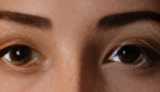

# KoboldCpp media server · MOSS / YuE2 / Wan

[Русский](README.ru.md) · [Windows kit](https://github.com/aktalascloud/koboldcpp-media-pipeline/releases/latest) · [API](docs/API.md) · [OWUI filter instructions](docs/MEDIA.ru.md) · [Models/licenses](docs/LICENSES.md)

One portable Windows media server built around [our Haswell AVX2 / RX580 Polaris/gfx803 KoboldCpp fork](https://github.com/aktalascloud/koboldcpp-avx2-vulkan-numa) and [original KoboldCpp](https://github.com/LostRuins/koboldcpp). One shared Native slot; the image model stays GPU-resident when idle. Models unload/load automatically. Run **Start.exe**; **Setup.ps1** is initial setup/update only.

| Task | Selected configuration | Public API |
|---|---|---|
| Images | Ray Artshoot Q8, Afterlight0.25 + RealismEnhancer1.0, Euler/simple8, CFG1, eta0, shift5, Cache-DiT0.08 | `/sdapi/v1/txt2img`, `/v1/images/generations` |
| Music | YuE2-3B Q8 + F16 VAE, caller-provided lyrics/style, MP3 stereo | `/api/extra/music/generate` |
| Video + soundtrack | Wan5B Turbo Q4, full encoder + Pro FP32 DirectML, Euler/beta4, CFG1, eta0, shift5 | `/v1/videos/generations` |

Normal/edit: **736×1104**, YuNet/GPEN20%/SFace0.97/Gater, no automatic SR. Explicit `enable_hr:true` adds ClearReality4×. High: **928×1392**, defaults to4×; the new High adapter combination has not been generated/measured. Native hires is off.

Video: native **480p**, Pro threshold576/actual320px tiles, WG512; ClearReality720p and guarded faces. Tiny/Super-Tiny are not used. YuE2 creates a separate musical track, muxed into MP4 without re-encoding video. This is not video-conditioned Foley or lip-sync. Optional RIFE48FPS preserves duration. The public kit has no private user video adapter enabled; local video measurements explicitly include one.

## Current saved example

| Actual Normal | Actual4× output (lossless full image linked) |
|---|---|
|||

Other scenes from the earlier28October recipe: [night](examples/night-processed.png), [watchmaker](examples/watchmaker-processed.png). They are historical examples, not measurements of the new adapters. [RGB provenance](examples/gallery.json).

## Measured scope

29October2026, Xeon E5-2696v3 / RX5802048SP8GB, EXE `ff7d4d0b`:

- Real public Normal, without explicit mode/size: **163.85s**. Ordinary4× API on that saved PNG: **6.04s**. These are two requests. [Image battle, all arms and cold/warm caveats](benchmarks/image-current.json).
- Real Pro + local user adapter +720p + faces + RIFE + YuE2 API examples: **190.76s** and **258.05s** for **17 native frames**, about **0.71s of footage**, not17seconds. The latter includes82.55s queue/profile readiness. [All video measurements](benchmarks/video.json).
- Light cache0.04/0.08 matched control latents in the tested scene;0.08 did not establish a consistent speed benefit. The current default is Cache-DiT0.04/warmup1 by user choice30October; no new gain is claimed. No universal speedup/long-clip claim.

## Setup

Download the code kit and run `Setup.ps1 -ListenHost 0.0.0.0` once for LAN use, then launch **Start.exe**. Main MOSS/Qwen weights and adapters come from original distributors/user imports; no main weights, keys, logs or caches are in this repository.

Pro is built once on CPU by `tools/SetupPro.py`: pinned original safetensors/source and temporary CPU PyTorch, using the same bundled Python. Serving afterwards needs only the three Pro graph/weight files and existing DirectML runtime. Optional RIFE is an original-download component; no Microsoft DLL is mirrored. [Video API/limits](docs/VIDEO.md) · [Original-download models](docs/MODELS.md).

## Unified workbench

`/media` and `/api`: image generation/redraw, music, video, ClearReality upscale, faces, Pro VAE, RIFE and soundtrack controls. Stable public API ports5001/5003 share one queue; private Native5005 switches automatically. `POST /v1/media/generations` accepts `{"type":"video","parameters":{...}}`; image/music also supported. `/openapi.json` lists routes. One user Helper.kcpps contains exact derived profiles; local idle GUI settings preserve the resident context. Default video cache is now Cache-DiT0.04/warmup1 by user choice; no new performance/quality benchmark.

Local Windows `KoboldCpp.exe` (~356MiB) embeds code/runtime, not model weights. `--background` supports logon, `--native-gui` opens the Native launcher. Optional `tools/BuildBundle.py` creates this owner-local artifact; it is not mirrored in this code-only release pending separate runtime redistribution review. Public kit still starts with Start.exe. No fresh-machine end-to-end generation claim.
