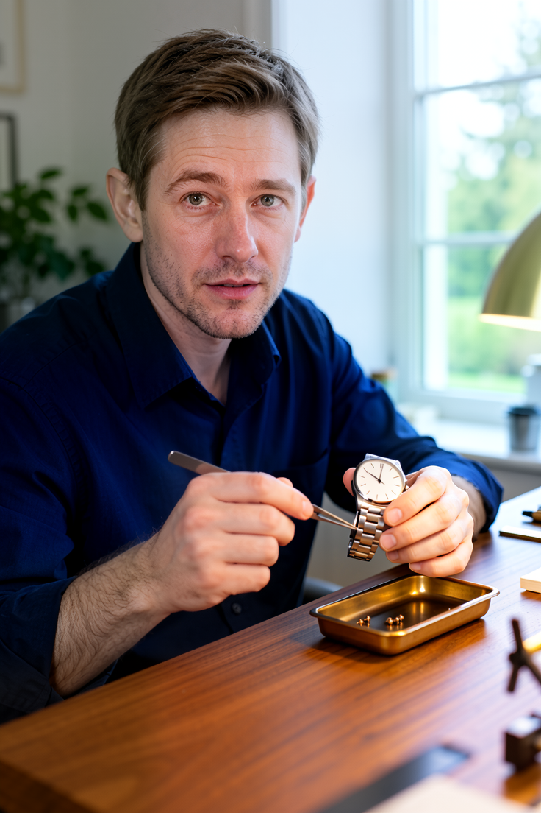
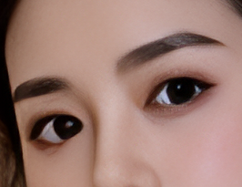
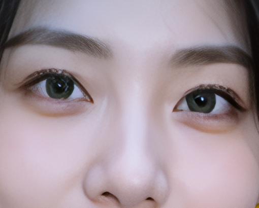

# KoboldCpp media pipeline · Refined Realism
[Русский](README.ru.md) · **[Windows kit](https://github.com/aktalascloud/koboldcpp-media-pipeline/releases/latest)** · [API / OpenWebUI](docs/API.md) · [Models](docs/MODELS.md) · [Licenses](docs/LICENSES.md)

Portable photo/music wrapper for **[our optimized KoboldCpp fork](https://github.com/aktalascloud/koboldcpp-avx2-vulkan-numa)** and [original KoboldCpp](https://github.com/LostRuins/koboldcpp). Tested on Haswell AVX2, AMD RX580 Polaris/gfx803, 8 GB. Kobold remains the backend; AUTOMATIC1111/OpenAI Images APIs connect through the proxy.

## Current MOSS results
**Refined Realism Q8_0 · DPM++ 2M SDE / sgm_uniform ·8 steps ·eta0.** Normal 736×1104; High 928×1392. LoRA off. Saved images only; publication did not generate or retouch them. [RGB/crop provenance](examples/gallery.json).

| Normal: faces/Gater | Night | Watchmaker |
|---|---|---|
|  |  |  |
|  |  |  |

| Exact Native source | Actual Normal 4× API result, labeled web preview |
|---|---|
|  |  |

The source RGB matches the actual request base. The full4× PNG includes faces, Gater and ClearReality; it is a full-chain comparison, not SR alone. Eye crops are unscaled saved pixels. Clock markings, fingers and skin texture can still contain generative artifacts.

## Measured speed
**Normal with automatic4×: 161.96 s**, one complete public API request,2944×4416. Native 150.259 s; faces 1.183 s; Gater 3.694 s; SR 0.962 s. Remaining time includes VRAM handoff and PNG/HTTP. Model was resident before the request; photo was restored afterward. **High Refined generation is not measured.**

Measured26Oct2026, EXE SHA256 `9cdacf216336f24d2585f4dab4f2602fe9f92728282094675b1b050febdd61ca`. [Evidence and all three-scene sampler measurements](benchmarks/results.json). DPM was selected by the user for appearance; it is not claimed faster than Euler/simple denoising. Repeat-prompt Qwen caching saves6–7 s in some trials and is separate from Cache-DiT. Native compiler stock/latest comparisons are in the linked core fork.

## Pipeline
Refined Q8 → YuNet960 → GPEN20%/SFace≥0.97 → Gater Restore1× → optional **ClearRealityV1 Normal FP32 DirectML4×**. No Helaman, skin/sharpen extra pass or repeated faces after SR. CFG1,shift5,FA,Cache-DiT `threshold=0.08,warmup=4,Fn=16,Bn=2`; CPU text encoder20 threads. Face bounds scale automatically; at most2 faces, larger faces may skip GPEN. High/SR releases only owned idle Native, then restores resident Normal. Music MP3 loads on API demand. Video deferred.

## Install and run
1. Extract `media-pipeline-code.zip`. Obtain the exact **Refined BF16 image source and gated Artius W4 text encoder**, or supply the verified derived GGUF files. Main weights are not in Git/releases. [Exact filenames, hashes and access](docs/MODELS.md).
2. Run `Setup.ps1 -MossSourceDirectory <folder-with-originals>` once. It verifies local originals, fetches pinned dependencies/postprocessors and converts locally. **Refined has no verified automatic-download URL; its source must be supplied.** GPEN comes from its original distributor, under Non-Commercial terms.
3. Launch **Start.exe directly**. `Start.exe --check` checks installation; `Start.exe --register-startup` opts into startup. One runtime, a separate visible Native window; no driver/BIOS/TDR changes. Default loopback; `-ListenHost 0.0.0.0` explicitly exposes the API.

Normal defaults to no SR; **`enable_hr:true` now requests proxy4× in Normal**. High defaults to4×; it has no new full-cycle timing yet. [Ready OWUI presets](docs/API.md). Original wrapper AGPL-3.0; third-party licenses remain separate. No keys, private addresses, logs, cache or state shipped.
