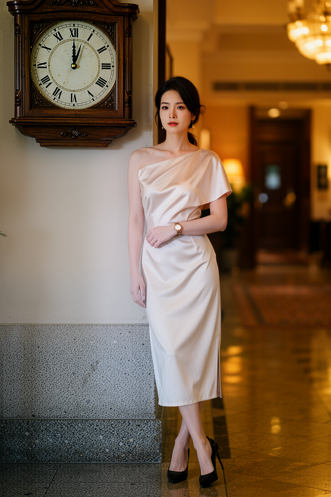
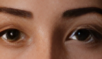

# KoboldCpp media pipeline
[Русский](README.ru.md) · [Release](https://github.com/aktalascloud/koboldcpp-media-pipeline/releases/latest) · [Install/build](docs/BUILD.md) · [API / OWUI](docs/API.md) · [Licenses](docs/LICENSES.md)

Portable Windows media around [our Haswell/AVX2 RX 580 Polaris/gfx803 fork](https://github.com/aktalascloud/koboldcpp-avx2-vulkan-numa) of [original KoboldCpp](https://github.com/LostRuins/koboldcpp). Run **Start.exe → KoboldCpp.exe**. Models switch exclusively; image stays GPU-resident when idle. Setup.ps1 is initial installation/update, not the launcher. No main weights are mirrored.

Goal: one portable KoboldCpp.exe with one runtime and a common on-demand API for photo, audio, video, effects and their combinations. The experimental core tracks official updates and selected security/model/performance patches for AVX2/Polaris; user-selected models and settings stay configurable.

- Default image recipe: Ray Q8, Afterlight0.25 + RealismEnhancer1, Euler/simple8, eta0, Cache-DiT0.08. Normal736×1104 without automatic SR; High928×1392 with ClearReality4x, supplemental High controls saved in the photo evidence. YuNet/GPEN20%/SFace0.97/Gater before SR, no repeat afterwards. Models/presets are configurable.
- Music: YuE2 MP3. SFX: SA3 CPU WAV/MP3,0.25–60s. Speech/helper/STT use a configurable provider and explicit RU/EN voices.
- Video: Wan5B Turbo, full encoder + Pro FP32, Euler/beta4, WG512, threshold576, ClearReality720p/faces, RIFE48FPS default/60 optional. Audio-driven lip-sync is a separate optional stage; this is not joint AV inference. Native limit121 frames; conservative tested clip73. Client project15s default/30s maximum.

**Current maintenance:1.125 / 2df2c89f,2026-11-04.** Fresh official source and retained ports; build/hash/startup/visible-window/GET checks only, no generation benchmarks. Stale protected PID reuse is now handled by read-only name/creation-time proof; ambiguous Native/Python/port ownership remains blocked.

## Latest saved results

Manual Normal photo comparison, **2026-11-02**: same current Ray/text/VAE/LoRAs and8 Euler/simple/Cache-DiT0.08 settings. Official stock `c66550f4` → fork `cb260832`, warm model-ready medians:

| Time | Stock | Measured cb260832 | Less time |
|---|---:|---:|---:|
| Native736×1104 |176.670s|146.815s|16.90%|
| Native + faces/Gater |184.423s|154.698s|16.12%|

The new FFN-view patch adds0.47% Native /0.37% pipeline versus the prior fork.184 CPU/Vulkan checks and17 unprofiled generations retained identical RGB. Public Normal API and separate4x2944×4416 passed, without repeating faces/Gater. Lossless PNG3 encoding1.566→1.052s, payload+1.4%, exact pixels/text. Full SR HTTP ranges overlap; no whole-request SR gain claimed. The matched engine table held PNG6 fixed; PNG3 is a separate serialization change. [Every repeat, first call, return control, model/SHA, API result and limitation](results/photo-latest.json).

Earlier media results retain their own dates/SHA:
| Saved test | Actual wall time | Scope |
|---|---:|---|
| PhotoNormal | 163.85s |29Oct, ff7d4d0b, one API |
| Separate photo4x | 6.04s |saved PNG, separate API |
| Music32sMP3 | 57.01s |28Oct,6c03b583, photo return61.07s |
| SFX2sWAV /6sMP3 |10.57s /17.17s |30Oct CPU, photo stayed resident |

Settings/ranges/dates/SHA: [one measurement file](results/measurements.json). **Current native1.125/2df2c89f has startup/GET acceptance only. The November2 photo cb260832 and saved video/token timings retain their own SHA.** Video samples used a private user adapter, not enabled/distributed in this kit. Historical timings are not a new speed claim.

| Actual Normal | Actual4x, full lossless image linked |
|---|---|
|||

Only necessary code/config/licenses and current results. Models/detailers/upscalers under MODELS, one runtime; all evidence under results. [Local-model build rules](AGENTS.md). Full owner-local EXE is built locally, not mirrored without runtime redistribution review. Fresh-machine full inference has not been tested.

## 1 November: verified changes
| Manual check | Result | Scope |
|---|---:|---|
| Native image, prior / fresh warm | 147.91 /147.60s | same8-step736x1104 scene;12 RGB-identical outputs across flags |
| I2V73 → Pro/Clear720/faces/RIFE48 | 583.63s |146 frames,3.04s; Native6053MiB VRAM, no OOM |
| Stored-video lip-sync at60FPS | 29.12s API |183 frames; CPU, photo process unchanged |
| Music + SFX + exact speech | 57.37s API | decoded video identical; exact WAV reused |

Pro502 after relocation was caused by an obsolete PowerShell monitor path. Audio mixing now uses finite sequential mix/mux/MP3 steps, avoiding a reproduced FFmpeg dual-output hang. Generations have persistent idempotent job receipts. Optional Wav2Lip is non-commercial, original-provider only; no perfect identity/articulation guarantee.73 frames are the conservative measured clip size;15/30s remains client orchestration, not a measured long AI movie. Models/settings/context are configurable; API aliases do not select arbitrary weight files.
