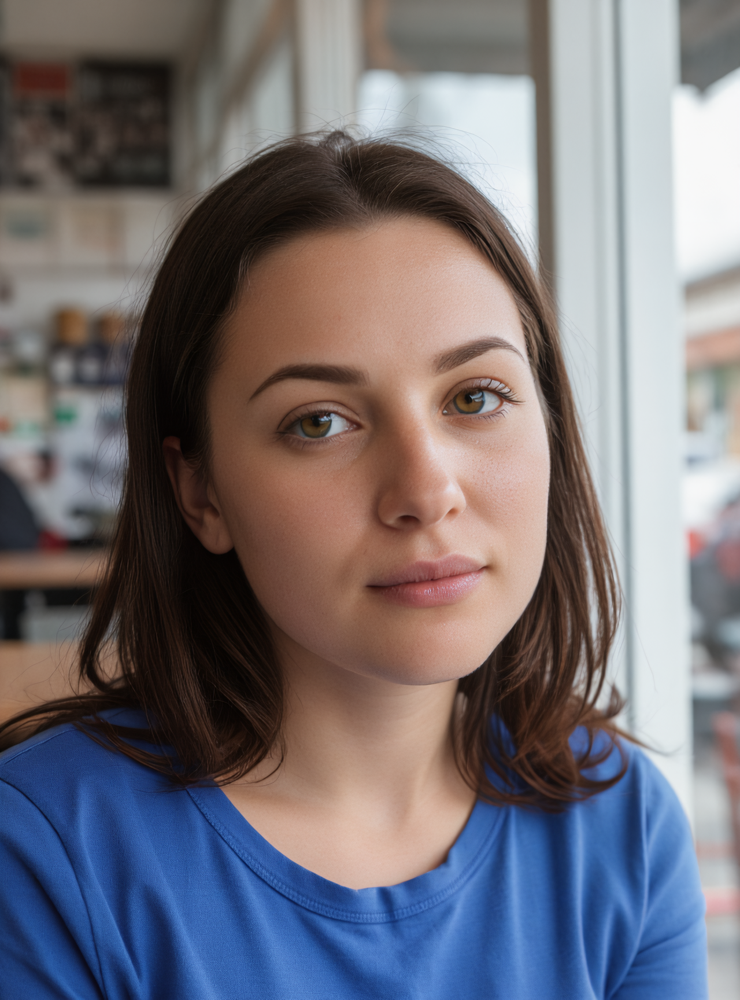
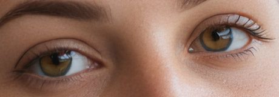
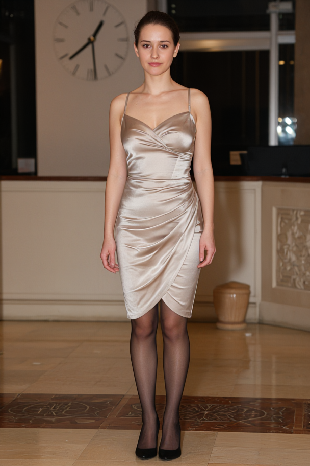
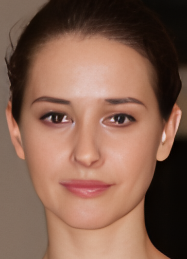
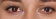
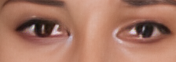

# Медиапайплайн KoboldCpp
[English](README.md) · **[Скачать](https://github.com/aktalascloud/koboldcpp-media-pipeline/releases/latest)** · [API / OpenWebUI](docs/API.md) · [Лицензии](docs/LICENSES.md)

Портативный Windows-комплект для Haswell/AVX2 и RX 580 Polaris/gfx803. **[Оптимизированный KoboldCpp](https://github.com/aktalascloud/koboldcpp-avx2-vulkan-numa)** остаётся бэкендом; прокси добавляет переключение моделей, обработку лиц, восстановление и Helaman 4×.

## Примеры качества
Готовые изображения прежних тестов, без новой генерации или ретуши для публикации. Этапы обработки различаются; [происхождение кадров](examples/historical-scenes.json).

| Портрет, Helaman 2× | Мастерская, 2× | Ателье, нативное разрешение |
|---|---|---|
|  |  |  |
|  |  |  |

### Полный рост, лицо и глаза
Исходник 608×912 уже обработан тремя LoRA, лицами и Gater. После Helaman — 2432×3648, без повторной обработки лица. Кропы сохраняют исходные пиксели.

| Обработанный исходник | Helaman 4× |
|---|---|
|  |  |
|  |  |
|  |  |

## Измеренная скорость
Одинаковые сцена 576×864, seed, три LoRA, лица и Gater; без SR:

| Исходный сток | Последний измеренный результат |
|---:|---:|
| 163,15 с | 138,35 с первым / **131,83 с прогретым** |

Прогретый цикл короче на **19,20%**. Это сохранённый тест 23 октября, отдельно от последующих сборок native. [Числовое доказательство](benchmarks/results.json).

Текущий Normal крупнее: **592×896, около 140 с прогретым**, без SR. Helaman 608×912 в 2432×3648: **194,90 с**, отдельная VRAM, около 7,41 ГБ dedicated memory. Генерация и возврат фотомодели в это время не входят. Полный High+4× после исправления памяти повторно не измерялся. Обработка не гарантирует правильную геометрию часов.

## Цепочка
1. Фотомодель Moody находится в GPU; Qwen-кодировщик — CPU, 20 потоков. Музыка загружается по API, выдаёт MP3, затем возвращается фото.
2. PhysioShade **0,15**, FlowDPO **0,35**, MaskedDPOFull **0,25**. Триггер **physioshade** добавляется один раз; повторно LoRA в запросах не подключаются.
3. Euler/beta, **8 шагов**, eta 0, CFG 1, shift 3, clip skip−1, Cache-DiT 0,08/warmup4/Fn16/Bn2; SD flash attention выключен.
4. YuNet 960, score 0,82; GPEN 512/OpenVINO CPU, смешивание 20%; SFace минимум 0,97, до 2 лиц. Размерные пороги зависят от разрешения.
5. Gater Restore 1× FP32 DirectML после лиц. Strength1, без sharpen.
6. Normal/edit **592×896**, без autoSR. High **1152×768**, портрет 768×1152, автоматический Helaman **4×**, без уменьшения и повторного лица.

Отдельный апскейл применяет лица/Gater до Helaman, если пиксельные маркеры не подтверждают готовую обработку. Супервизор выгружает только свой свободный Native, отдаёт SR всю VRAM и возвращает фото. Видео отложено; его веса/runtime не включены.

## Установка
Распакуйте **media-pipeline-code.zip**, один раз запустите **Setup.ps1**, далее — **Start.exe напрямую**. Компоненты скачиваются по SHA; крупные Moody/Qwen/AceStep — из исходных источников. Одна runtime-копия. Start.exe --check проверяет установку.

Автозапуск включается отдельно: runtime/python/python.exe -I -B tools/Launch.py --register-startup. Kobold работает в отдельном видимом окне. API 5001/private Native 5003 по умолчанию loopback; сетевой доступ настраивается явно.

Код — AGPL-3.0, сторонние условия сохранены. GPEN — отдельный **Non-Commercial** ассет. Ключи, личные адреса, кэши и логи не публикуются. [Лицензии](docs/LICENSES.md) · [Оригинальный KoboldCpp](https://github.com/LostRuins/koboldcpp).
