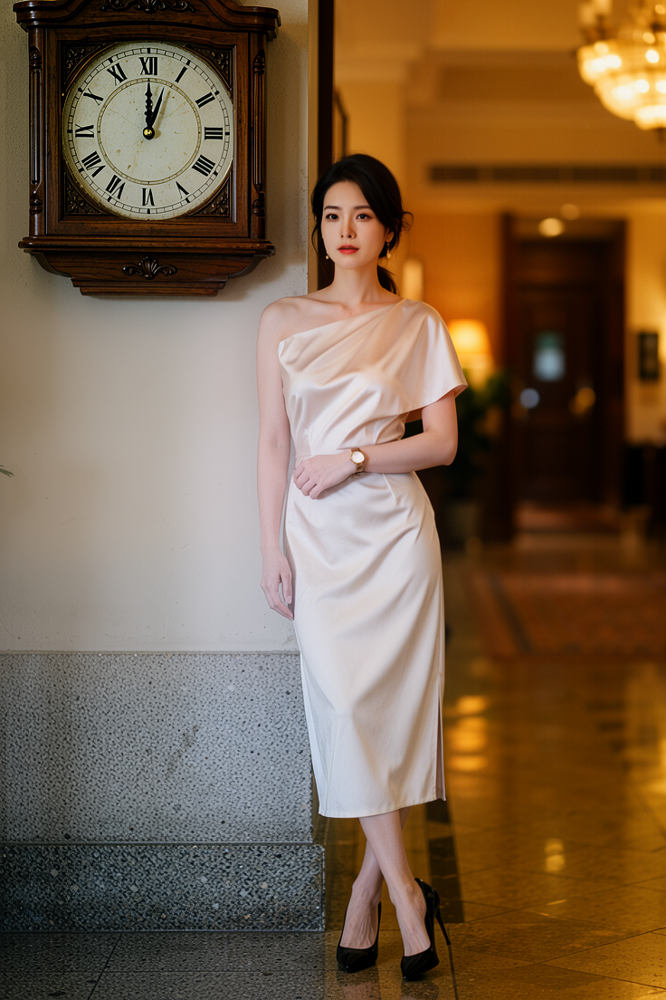

# Медиакомплект KoboldCpp
[English](README.md) · [Установка/сборка](docs/BUILD.md) · [API и ТЗ OWUI](docs/API.ru.md) · [Лицензии](docs/LICENSES.md)

Один переносимый Windows-сервер на [оптимизированном форке Haswell/AVX2/RX 580 Polaris/gfx803](https://github.com/aktalascloud/koboldcpp-avx2-vulkan-numa). Запуск **Start.exe → KoboldCpp.exe**. Setup.ps1 нужен при установке/обновлении. Фото в GPU при простое; музыка/видео загружаются по требованию. Главные веса не зеркалируются.

Пример конфигурации фото: Ray Q8, Afterlight0,25 + RealismEnhancer1, Euler/simple8, eta0, Cache-DiT0,08. Normal736×1104 без автоапскейла; High928×1392 с ClearReality4x, дополнительные High-контроли сохранены в фотоотчёте. YuNet/GPEN20%/SFace0,97/Gater выполняются до апскейла, без повтора после него. Модели и параметры выбираются в конфигурации. Музыка — YuE2 MP3; эффекты — SA3 CPU WAV/MP3 до60 с. TTS/хелпер/STT настраиваются, язык и голоса RU/EN задаются явно.

Видео: Wan5B Turbo, полный энкодер + Pro FP32, Euler/beta4, WG512, порог576, ClearReality720p/лица, RIFE48 FPS по умолчанию или60 по запросу. Звук и lip-sync — отдельные этапы, не совместная AV-генерация. Предел Native —121 кадр, проверенный проход —73. Проект15 с по умолчанию, максимум30 с: его собирает клиент; длинный AI-рендер пока не измерен.

**Core 1.125 · 2026-11-11 · Native `fdc3d11d`.** Официальная база `f49df57`. [77 патчей](https://github.com/aktalascloud/koboldcpp-avx2-vulkan-numa/tree/concedo_experimental/performance/patches/series).

## Замеры токенов, музыки и фото · 11 ноября

| Нагрузка | Было → стало | Изменение |
|---|---:|---:|
| CPU · prompt | 72.313 → 73.305 tok/s | ≈+1.37% |
| CPU · decode | 17.251 → 17.148 tok/s | ≈-0.60% |
| RX 580 · prompt | 312.988 → 313.767 tok/s | ≈+0.25% |
| RX 580 · decode | 34.261 → 34.381 tok/s | +0.35% |
| YuE2 · 32 s | 43.900 → 43.910 s | +0.02% |
| ABDM Normal | 150.809 → 151.281 s | +0.31% |
| ABDM 4× | 2.712 → 2.639 s | ≈-2.70% |

Тот же GGUF Qwen3-4B IQ4_XS, профиль YuE2 и профиль ABDM Normal. Текст, семантические коды, MP3, PCM и RGB совпали. Символ ≈ обозначает пересечение диапазонов. Для полного запроса YuE2 по одному тёплому замеру.

[Повторы и хеши](results/performance-2026-11-11-multimodal.json) · [Операции](results/operations-2026-11-11-multimodal.json) · [Диффы PR](results/pr-review-2026-11-11-multimodal.json)

## Примеры Ray Artshoot · 7 ноября

[Полный4x](results/photo-4x.webp) · [Глаза4x](results/photo-eyes.png). Последние примеры и данные только в results; модели/улучшалки/апскейлеры — MODELS, runtime один. [Правила локальной модели](AGENTS.md). Полный локальный EXE собирается на машине владельца; публично не зеркалируется без проверки прав на сторонний runtime. Полная генерация на чистой машине не тестировалась.

## Проверено 1 ноября
| Проверка | Время | Что измерено |
|---|---:|---|
| Генерация прежним / свежим Native | 147,91 /147,60 с | повторный запрос,8 шагов,736×1104;12 побитово одинаковых RGB |
| I2V73 → Pro/Clear720/лица/RIFE48 | 583,63 с |146 кадров,3,04 с; пик Native6053 МиБ VRAM, без OOM |
| Lip-sync сохранённого60FPS видео | 29,12 с API |183 кадра; CPU, процесс фото не менялся |
| Музыка + SFX + исходный WAV речи | 57,37 с API | видеокадры совпали, речь повторно не генерировалась |

Причина воспроизведённого502 — устаревший путь PowerShell-монитора после переноса папок. Аудиомикс теперь состоит из ограниченных последовательных этапов, без зависавшего двойного вывода FFmpeg. Для генерации ведётся журнал идемпотентных заданий. Необязательный Wav2Lip — Non-Commercial, только исходный распространитель; идеальная артикуляция/личность не гарантируется.73 кадра — проверенный размер прохода;15/30 с собирает клиент, полный длинный AI-рендер не измерен. Модели, настройки и контекст задаются конфигурацией, API alias не выбирает произвольный файл весов.
