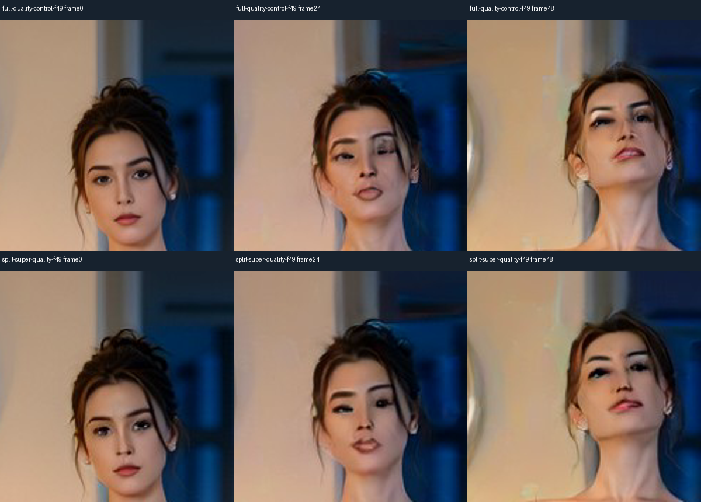

# Video on RX580

Wan2.2 TI2V5B Turbo Q4: 4 Euler/simple steps, CFG1, shift5, 24FPS. Native generation is 480p; optional ClearReality upscales the short edge to 720p while preserving aspect. Full Wan VAE is the quality default. The optional Super-Tiny decoder was much faster but visibly softened eyes; it is not enabled by default.

`POST /v1/videos/generations`: `{"prompt":"A cinematic landscape with gently moving clouds","frames":17,"resolution":"480p","orientation":"landscape","upscale_to":"720p","enhance_faces":true}`. For image-to-video add `image` containing PNG base64. For continuation add `continue_from` with a previous video ID. `POST /v1/videos/upscale` accepts `{"video_id":"...","enhance_faces":true}`. GET `/v1/videos/capabilities` reports limits. Models switch through the shared supervisor; photo is restored after video/postprocessing.

Use 4n+1 frames, 5..121, one clip per request, with a 900s total budget. Only 17/49 frames were tested; start with 17. Full VAE took 831s for 49 frames before cold load/SR, so the complete chain can exceed the budget. Continuous 30-second output is not validated. No frame interpolation/duplication or duration stretching. Optional YuNet / GPEN20% / SFace.97 uses DirectML and guarded motion-compensated residual smoothing. Missing eye/anatomy detail cannot be guaranteed recoverable. No adult-action adapter is active.

[Manual timings and scope](../benchmarks/video.json). Main model weights and FFmpeg are fetched from pinned original sources, not mirrored.

## Saved comparison

[Full VAE: 49 frames, 831.11s](../examples/video-full480.mp4) · [Faster approximate configuration: 49 frames, 140.06s](../examples/video-super480.mp4). Both are 480×832 at 24FPS, about 2.04s of video. These are different VAE/tiling configurations, not a decoder-only A/B. Full VAE better preserves eyes in these crops.

