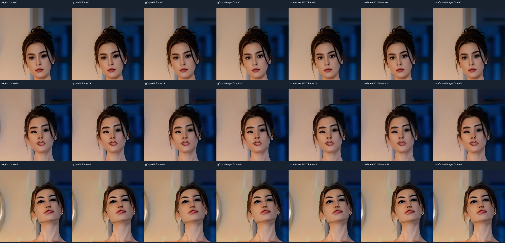
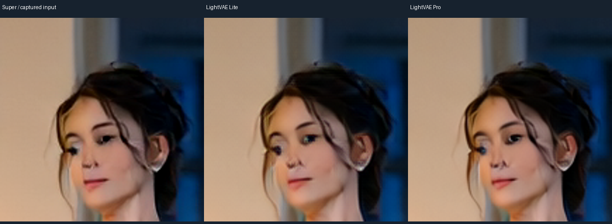
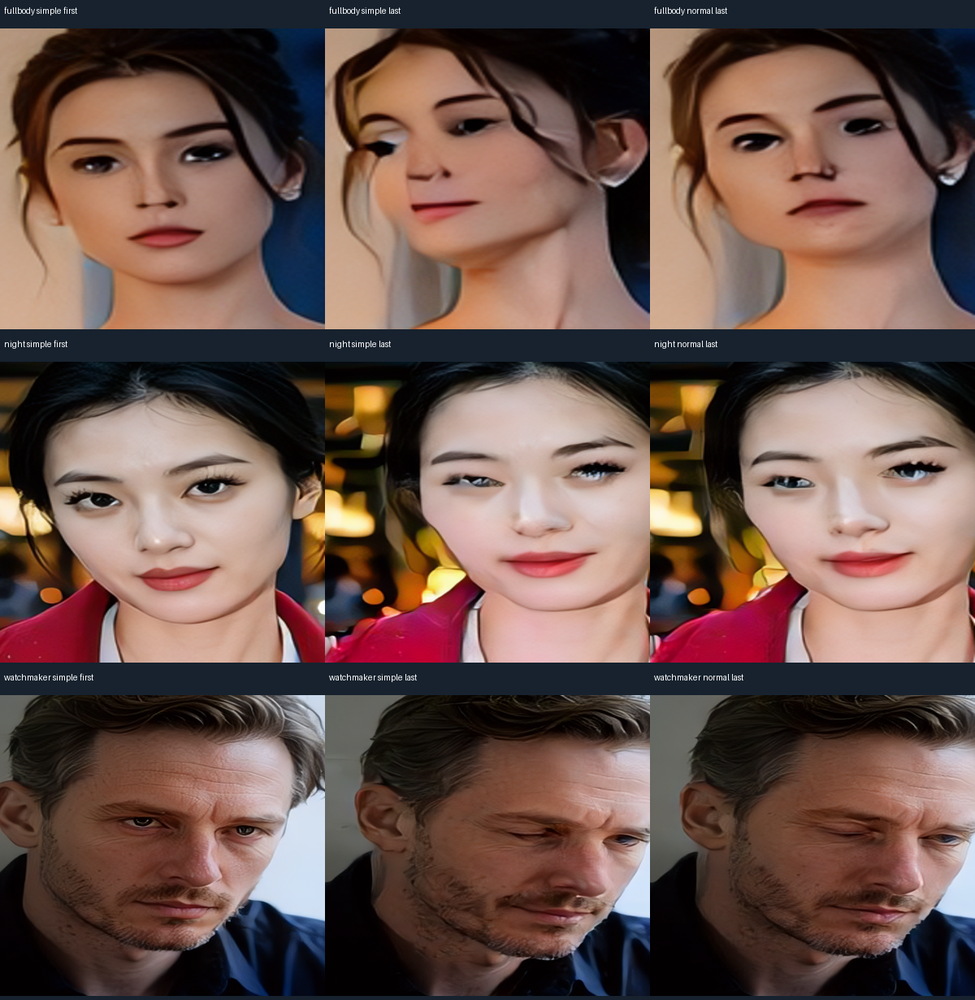

# Video research: 28 October 2026

All comparisons use saved/generated neutral adult scenes. Raw latents, candidate weights, runtime logs and process IDs are excluded. [Exact timings and scope](../benchmarks/video-research.json).

| Face restorer | Three saved frames, seconds | Accepted faces |
|---|---:|---:|
| GPEN20% |1.284|3/3|
| GFPGAN35% |0.928|3/3|
| CodeFormer35%, fidelity0.7 |1.430|3/3|
| CodeFormer60%, fidelity0.5 |1.429|1/3|

On the same49-frame video, ClearReality720 plus GFPGAN35% took52.76s versus56.08s with GPEN20%. There was no convincing eye-quality improvement, so GPEN remains selected. SFace stays≥0.97. Models were downloaded from the original FaceFusion assets release, not mirrored here.

## Alternative VAE decoders

Native captured the actual raw posterior means after sampling. Lite and Pro decoded exactly that same input; no re-encoding of an already-generated JPEG was used.

| Decoder |17-frame decoder time, seconds|Decision|
|---|---|---|
| Selected Super-Tiny / Native |0.85|Fast default retained|
| LightVAE Lite / DirectML |11.50,10.71,10.68|Tested candidate;not installed as a public API mode|
| LightVAE Pro / DirectML |45.91,39.14,46.93|Better eye structure,but observed7458MiB dedicated/2823MiB shared;not deployed|

These are decoder timings, not full API latency. Prior full-VAE tiled decoding took158.76s for17frames, with a different tiling setup. Tested Pro streaming/binding/FP16 variants that exceeded the memory guard were rejected. Shared allocation is not proof of Windows pagefile activity. Super was also checked against its original MIT PyTorch reference: last-frame PNG max difference1RGB level,mean0.0000543.

## Factory samplers and schedules

Selected: **Euler/simple,4steps,CFG1,shift5,eta0,no cache**. Full-body, night and watchmaker controls did not establish a consistent natural-motion/quality advantage for normal/discrete. Beta, shift8, factory-like flow-LCM and the3-step DPM approximation did not win the full-body screening.

The original manufacturer's code uses4warped timesteps1000/750/500/250,shift8 and fresh re-noising. Native flow-LCM was tested as an adaptation, not claimed bit-identical. The GGUF converter separately recommends Euler/SA_Solver/Uni_PC and simple/normal/beta. UniPC/SA_Solver are not exposed by this Native API. Native DPM++2M SDE is midpoint, not the workflow's Heun variant. LCM re-noises even with eta0;eta does not control that solver.

[All single-run measurements, SHA and limitations](../benchmarks/video-samplers.json). Tiny subsecond differences are retained without a statistical speed claim.17frames means0.708s, not a long clip.

## Video face-size fix

The old fixed240px cap toggled restoration on medium faces after720p SR. Bounds now scale from32..192px at480p to48..288px at720p. Both night finalists processed17/17frames instead of14/17and13/17. The large watchmaker face is intentionally skipped; zero applied faces is not reported as successful restoration. Photo settings are unchanged.
