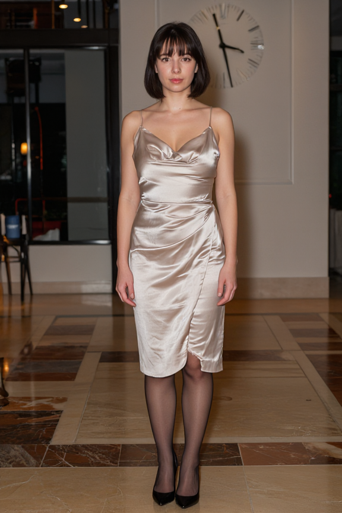
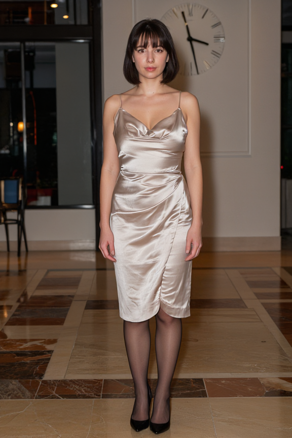
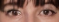
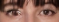
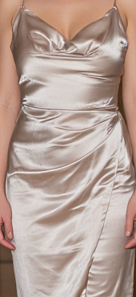
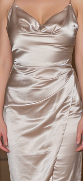
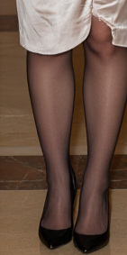
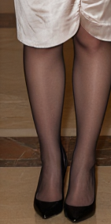
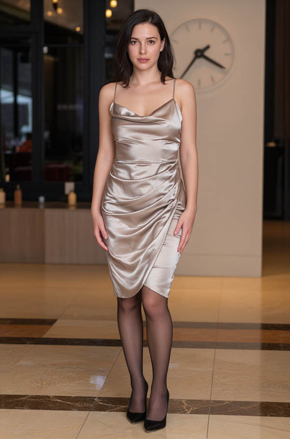

# Existing benchmark images

The selected quality gallery is on the [main README](../README.md#selected-results), with [per-scene provenance](historical-scenes.json). The images below are historical performance controls, including known artifacts; they are not all selected quality examples.

No new generation was performed for publication. These images come from the same synthetic adult fashion/hotel/night/clock test, seed424242. PNGs were re-encoded only to remove metadata; RGB pixels were preserved. The subject is a generated adult, not a user's uploaded reference photo.

| Stock576×864 |New build576×864, same processing |
|---|---|
|||
|||
|||
|||
|||

The compiler comparison keeps the model/LoRA/sampler/refinement unchanged. Stock and new can differ in a few pixels; outputs of the two optimized builds were identical. Do not use this to claim perfect anatomy: the clock still has a baseline extra-hand defect.

Current larger Normal592×896, all3LoRA+faces+Gater,noSR,140.09s warm:

Separately measured Helaman input608×912 and full4x2432×3648. Exclusive SR194.90s versus516.15s co-resident; final RGB byte-identical. This different input is deliberately labeled and is not a matched size comparison with592×896.

|Before SR608×912|After native4x2432×3648|
|---|---|
|||
